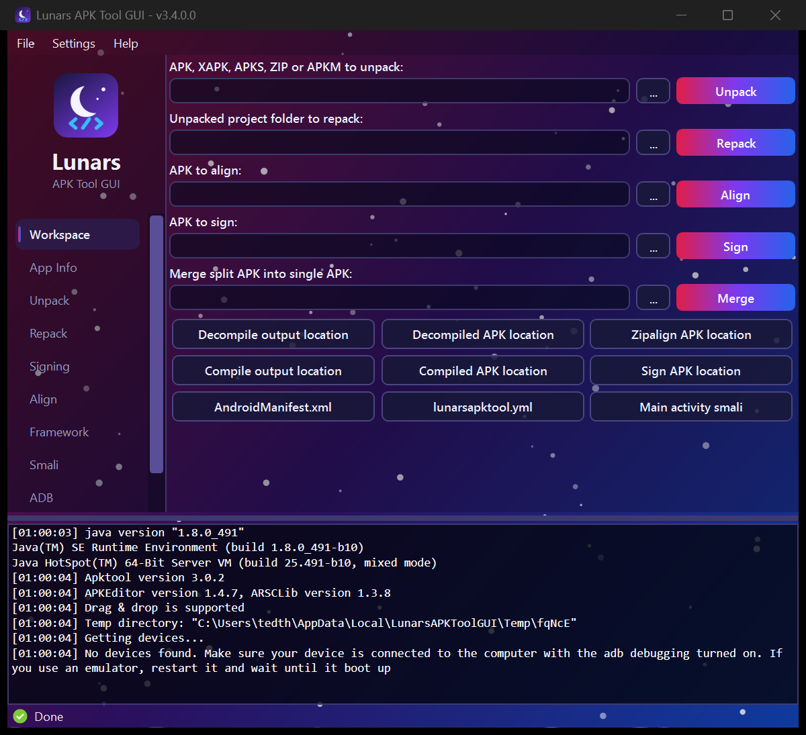

<div align="center">


# Lunars APK Tool GUI

**A modern, dark-themed Windows GUI for Apktool, APKEditor, SignAPK, Zipalign, Baksmali and ADB.**

[](https://github.com/roleplayleecounty-collab/LunarsAPKToolGUI/releases/latest)
[](https://github.com/roleplayleecounty-collab/LunarsAPKToolGUI/releases)




</div>

---

## Quick start

1. **Download** the latest `LunarsAPKToolGUI.zip` from the [Releases page](https://github.com/roleplayleecounty-collab/LunarsAPKToolGUI/releases/latest), or grab the [`LunarsAPKToolGUI`](LunarsAPKToolGUI) folder from this repo.
2. **Extract** it anywhere. Keep `LunarsAPKToolGUI.exe` next to its `Resources` folder.
3. **Run** `LunarsAPKToolGUI.exe`.

> Only the ready-to-run app is published here. No source code is included in this repository.

## Features

- Unpack and repack APKs with **Apktool**
- Unpack **APK / XAPK / APKS / ZIP / APKM** and merge split APKs with **APKEditor**
- **Sign** and **Zipalign** APKs
- **Baksmali / Smali** support and **ADB** tools
- Framework management and APK info viewer
- Drag and drop, right-click context menu, live log output
- Create unsigned APKs for Core Patch
- Red-to-blue gradient look with a sidebar layout and snow that falls and piles up in the background
- Unpacked projects use `lunarsapktool.yml` (renamed back to `apktool.yml` automatically while repacking)
- Dark and light themes, multi-language, High DPI and long path support

## Requirements

| Requirement | Notes |
|---|---|
| Windows 7 or newer (32/64-bit) | |
| [Java](https://www.java.com/en/) / JDK 8 or newer | Use the 64-bit build on 64-bit systems |
| [.NET Framework 4.8](https://dotnet.microsoft.com/en-us/download/dotnet-framework/net48) | Preinstalled on Windows 10 and 11 |

## Folder layout

```
LunarsAPKToolGUI/
├── LunarsAPKToolGUI.exe
├── LunarsAPKToolGUI.exe.config
└── Resources/        apktool, APKEditor, apksigner, aapt, adb, zipalign, smali...
```

## FAQ

**Antivirus flags the app.** This is a false positive caused by how the tool launches Java and other executables. Add `LunarsAPKToolGUI.exe` to your exclusions.

**How do I update Apktool?** Replace `Resources\apktool.jar` with a newer release from [Apktool](https://github.com/iBotPeaches/Apktool/releases).

**How do I reset settings?** Delete `config.xml` next to the executable.

**macOS / Linux?** Run it through [WineHQ](https://www.winehq.org/).

## Support and issues

Open an [issue](https://github.com/roleplayleecounty-collab/LunarsAPKToolGUI/issues). For Apktool-specific problems check the [Apktool tracker](https://github.com/iBotPeaches/Apktool/issues) first. Bypassing app protections is out of scope and will not be supported.

## Credits

**Developer:** Lunars - design, development and branding.

Bundled open-source tools, each under its own license: [Apktool](https://ibotpeaches.github.io/Apktool/), [APKEditor](https://github.com/REAndroid/APKEditor), smali/baksmali and the Android SDK tools.

## Disclaimer

Like Apktool, this tool is **not** intended for piracy or other unlawful use. Use it for localization, adding features, research and other legitimate purposes, and respect app authors.

## License

See [LICENSE](LICENSE).
